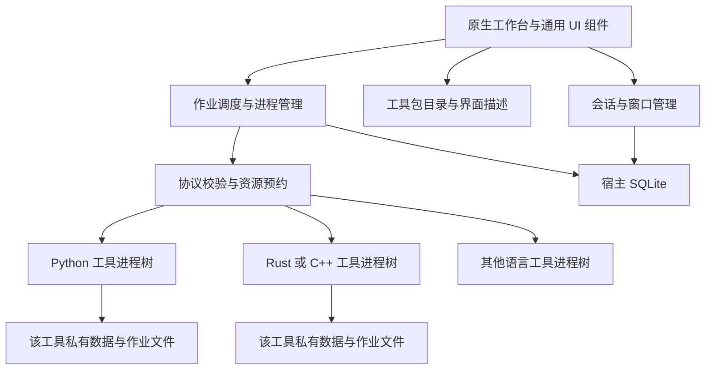

# ModynToolbox完整架构与开发方案

2026-11-08 独立项目开发基线。本项目承接已经明确的工具箱需求，从零建立应用、独立工具、启动方式和交接记录。本文件记录规划基线，应用已从 T01 开始实施，实时完成范围见 STATUS。

用户要求将项目放到独立的一级项目目录，前台轻量、工具界面按实际任务开发，工具业务与依赖独立，目录清楚，能从 VS Code 启动并跨电脑、跨 Agent 接手。技术基线为 C++20 / Qt 6 Widgets 宿主与跨语言进程后端。

[需求规范](spec.md) 定义行为与验收。[开发指南](development.md) 定义源码/发布目录、启动、数据根与迁移。[交接指南](handoff.md) 定义记录消费方式。精确依赖和资源预算在 M0 验证后锁定。

## 1. 决策依据与技术选择

### 1.1 优先级与成立条件

硬约束包括 Windows 桌面、前台响应与低常驻占用、界面统一接入、各工具业务和环境独立、多会话及独立窗口。首版使用可信本地工具，离线执行。现有项目只有文档和 HTML 参考，没有必须沿用的应用代码或现成业务运行环境。

工程判断采用以下优先级。

1. 后端与宿主通过进程边界隔离，语言和库版本可独立。
2. 前台按需创建视图，避免为每工具驻留运行环境。
3. 显式控制内存、缓存、并发、进程树与文件写入。
4. 用成熟桌面控件实现所需表格、参数区和编辑器。
5. 承担可解释的构建、发布和维护成本。

尚缺目标电脑配置、具体最大数据量和未来工具类型，故没有依据承诺某框架的绝对最小内存、毫秒启动或最终包体。优先级排序是依据用户当前表达所作工程取舍。

### 1.2 宿主候选

| 候选 | 对本需求的价值 | 成本与结论 |
|---|---|---|
| C++20 / Qt 6 Widgets | 原生编译宿主，成熟控件/模型视图、多窗口、异步进程，资源生命周期可直接管理 | 构建与 C++ 维护要求较高，Qt 库/插件仍有体积。作为轻前台优先的建议基线 |
| C# / WPF | Windows 桌面控件、绑定、样式与开发效率完整，可接同样的独立进程协议 | .NET 发布方式及托管分配需测量。若原型资源数据相当且工程成本明显较低，可作为有依据的替代 |
| C# 或 C++ / WinUI 3 | 微软面向新 Windows 应用推荐的 UI 框架，现代系统集成 | 自定义工具视图、多窗和实际分发仍需原型，官方推荐本身不等于本产品内存最小 |
| Tauri / Rust / Web | Web 组件与跨平台界面表达强，后端可接任意执行器 | WebView、IPC 与多窗口成本仍存在，当前统一原生界面要求没有迫使引入 Web 渲染层 |
| Electron / Web | Web 生态和前端迭代方便 | Chromium/Node 与多渲染进程成为基础成本，当前低占用优先级下不作为首选 |
| Python / PySide6 | 工具原型、Python 脚本整合快速 | 宿主额外携带 Python 与绑定层。后端已可独立使用 Python，宿主无需由脚本生态决定 |
| 直接 Win32 或其他轻型原生库 | 可进一步减少框架依赖 | 高级控件、可访问性、多 DPI 和主题需更多基础实现，当前功能范围下工程负担较高 |

上述为架构判断。尚未运行相同功能的候选基准，也没有给各框架虚构分数或 MB 排名。

### 1.3 建议开发基线

- 宿主采用 C++20、Qt 6 Widgets，构建采用 CMake，Windows x64 使用一个明确锁定的 MSVC 工具链。具体版本以 M0 的兼容/发布验证为准。
- 核心依赖为 Qt Core、Gui、Widgets、Sql 及 SQLite 驱动。图标优先小型本地资源，追加模块需有实际用途。
- 工具通过可执行入口接入，可用 Python、C++、Rust、C#、Go 等实现。首版协议与这些语言无绑定关系，首批只验证实际使用的两种语言。
- 界面使用版本化 JSON 描述与受控原生组件，业务通过 worker 完成。
- IPC 使用子进程 stdin/stdout 的 UTF-8 JSON Lines，诊断走 stderr。大数据用文件引用。
- Windows 每作业进程树采用 Job Object 管理，异步管道通过 QProcess 或必要的 Windows 启动适配器连接。
- 宿主状态使用 SQLite，工具私有数据按 tool_id 分开。
- 发布使用 Qt 部署文件夹与独立工具包，语言运行时按工具部署。Qt 及第三方模块许可随实际依赖核对并携带相关材料。

该基线的取舍是减少前台运行层次，并承担 C++ 工程成本。计算任务最终速度仍取决于各工具处理器。

## 2. 模块与进程结构



主窗和工具独立窗均由宿主 UI 进程绘制。后端默认每作业创建一个进程树，结束后回收。窗口移动只改变会话的显示位置。

启动优先读取宿主数据库中的已安装目录缓存，图标与完整界面描述按需读取，包验证在受控后台执行。搜索使用元信息索引，目录变化触发局部更新，避免启动时初始化全部工具及其运行环境。

| 组件 | 职责 | 覆盖 |
|---|---|---|
| PackageCatalog / PackageManager | 登记、版本固定、兼容检查、可信本地包导入与移除 | F01,F07,F19 |
| ViewSpecValidator / NativeViewRenderer | 校验组件树、原生布局、绑定与动作，限制深度/节点/负载 | F12,F16,N07,N09 |
| SessionStore / WindowManager | 独立会话、输入修订、单栏/双栏、顶层窗口、parked 恢复 | F02,F03,F04,F06,F20 |
| JobScheduler / WorkerSupervisor | 队列、并发、快照、启动、协议、取消与终态 | F05,F11,F18,N03 |
| ResourceLease / WindowsProcessGroup | 文件预约、所属进程树、资源统计和配置的限制 | F13,F18 |
| StateRepository | 宿主元信息、草稿策略、迁移与恢复 | F06,F14,F17,N04 |
| Tool worker | 自己的扫描、业务校验、处理、结果和恢复记录 | F08,F09,F10,F17 |
| ArtifactStore | 输入快照、结果、所有权、引用、限额与安全清理 | F06,F18,N06 |

依赖从宿主服务指向通用契约。工具之间没有业务导入。业务后端代码运行在各自进程，主程序不动态载入工具业务 DLL 或 Python 模块。操作系统、Qt 平台和 SQLite 等基础库仍是宿主正常依赖。

## 3. 工具包与关键对象

### 3.1 目录与清单

```text
<packages_root>/<tool_id>/<package_version>/
  manifest.json
  ui.json
  assets/
  backend/                 # 工具代码/可执行入口
  runtime/                 # 自包含运行环境，或使用已安装 runtime_ref
  dependency-lock.*        # 对应语言的锁定清单
  LICENSES/
```

manifest 包含 tool_id、package_version、manifest_version、ui_schema_version、protocol_version、最低宿主能力、名称/关键词/图标、配置默认值、动作 ID 及交互/批处理类别、entry_program/entry_args、runtime_ref、状态 schema 版本、并发组、启动/取消策略、是否写文件及资源预算。

tool_id 是稳定标识。版本元数据不能由界面标题推导。可执行文件及参数分开声明，路径相对该包解析并检查。禁止经 shell 拼接一整行命令。运行环境存在与完整性校验通过后才可启用工具。

首版自包含环境始终可用。精确环境指纹相同的包允许引用同一份应用管理、运行时不修改的环境目录。该能力仅去重磁盘文件。配置不兼容时使用独立环境，不能用启动后 pip 安装/升级解决。

### 3.2 模型

| 对象 | 主要字段与不变量 |
|---|---|
| ToolDefinition | 包标识、UI/协议版本、动作和执行入口。纯登记信息可在启动读取 |
| SessionState | session_id、tool_id、package_version、draft_schema、input_revision、参数/输入引用/UI 状态。每会话独立 |
| Placement | parked/main/floating、主区槽或独立窗 ID、几何和屏幕信息。最多一个可见编辑视图 |
| JobRequest | job_id、session_id、包版本、operation、输入修订、不可变参数、input_ref、resource_claims_ref |
| JobEvent | job_id、session_id、seq、kind、phase、计数、取消能力、结果引用与实际副作用 |
| JobOutcome | succeeded/failed/cancelled/interrupted、计数、输出引用、partial_effects、recovery_ref |
| ArtifactRef | artifact_id、归属、相对位置、大小/类型/可选摘要、生命周期，避免任意路径混入结果 |

宿主保存工具版本和公共会话状态。后端可在请求指定的私有目录读写自身数据，不持有 Qt 对象或宿主数据库连接。

### 3.3 公共调用边界

| 调用 | 输入与输出 | 失败/副作用 |
|---|---|---|
| install_package(source) | 校验包 → 新的可用版本 | 校验失败保留旧版本，暂存文件按归属回收 |
| create_session(tool_id,version) | 固定版本 → 新 session_id | 不兼容包显示原因，创建失败不留下半份会话 |
| render_session(session_id) | 校验 UI 描述 → 原生视图 | 未知组件显示工具错误面板，限制过深/过多节点 |
| move_session(session_id,target) | 同模型迁移或重建视图 → Placement | 不提交作业，失败恢复原位置 |
| submit(session_id,action) | 验证 → 快照 → 排队 → job_id | 活动作业去重，预检不写用户文件 |
| cancel(job_id) | 依阶段请求 → 当前状态 | 提交关键阶段明确返回取消不可用 |
| collect_outcome(job_id) | 完整协议终态及退出结果 → Outcome | 只有退出码不能判业务成功，失败保留已发生影响 |

## 4. 统一原生界面规范

工具提供有版本的 UI 描述，宿主提供组件实现。首版通过三个真实工具形成有限的接入能力。

| 能力 | 首版范围 |
|---|---|
| 布局 | 行/列、分隔、表单、可伸缩主区、窄窗口重排 |
| 输入 | 文本、整数、开关、下拉、文件/目录选择 |
| 内容 | 基于模型的表格、普通文本编辑、图片预览、状态/错误 |
| 动作 | 命名 action_id、选择输入、执行、取消、复制/导出、打开结果 |
| 绑定 | 字段取值与显示、基本相等/布尔条件、启用/可见条件 |
| 主题 | 固定语义 Token 与控件角色，工具沿用工作台样式 |

UI 描述无任意代码执行或动态原生类名。组件、字段和动作引用必须已知，条件规则是有界的简单声明。首版不开放无限表达式解释器。各工具可自由组合已有组件，表格/编辑器/图片界面分别有合适布局。

M0 建立 UI 描述大小、树深、节点与一次变更的负载上限并写入协议附表。表格数据不展开成几千份控件，按模型批量更新。超大结果按页/按引用读取，界面不一次持有全部图像解码内容。结果解析/索引读取在受控后台线程处理，UI 线程只应用有界增量。

初始 view_spec 只建立三工具所需组件。出现全新交互时增加通用组件并提升 ui_schema 能力，再让依赖它的包声明最低要求。一般工具可独立发包，新增原生组件需要宿主更新，这是所选接入规范的工程成本。

图片缩略图限制并缓存小尺寸内容，按总字节上限 LRU 淘汰。JSON 编辑保留输入修订号，修改正文使旧结果状态过期。参数改变使已确认的重命名计划失效。

同一 UI 进程是共享故障域。有界数据、批处理、协议验证和成熟组件降低异常传入风险，宿主组件本身的缺陷仍可能影响所有窗口。

## 5. 跨语言通信

### 5.1 通道与消息约束

首版通过受管理子进程管道通信，不依赖本地 Web 服务。stdout 为 UTF-8 JSON Lines，stderr 为有界诊断，stdin 传控制消息。适配已有 CLI 时使用薄包装器，把其输出转成公共协议。

每行最多 64 KiB，行缓冲与待处理队列另有限额。大文本、文件批次、资源清单和大结果采用 ArtifactRef。协议中的 ID 和时间戳用字符串，计数仅使用跨语言可精确表示范围内整数，业务高精度数值通过原始文本/文件保存。

传输对象与解码/协议校验运行在专用 I/O 线程或 Windows 异步 I/O 层，按对象线程归属创建和使用 QProcess。有界验证事件再排入主线程。UI 不同步解析海量原始输出。按字节重组半行和跨读取的 UTF-8 字符，多行读取逐行处理。EOF 后仍有不完整消息才报传输错误。SDK 使用单一消息写入通道串行分配 seq，避免后台业务线程并发写 stdout 交错。

共同 envelope 包含 protocol_version、kind、tool_id、session_id、job_id、seq。动作携带 operation、input_revision、config 与文件引用。事件包括 ready、progress、phase、result、error、cancel_ack，result 是候选终态。

校验顺序为长度/编码 → JSON 类型 → 协议版本 → 当前作业/工具/会话身份 → 序号及允许状态 → 数据字段/引用 → 应用事件。错误拒绝进入模型，记录到对应作业诊断。大消息和日志洪泛触发受限失败处理，不能无限积压。

进度按建议每作业最多 10 次/秒合并，结果与错误可靠保留。终态数据落作业文件后发引用，进度合并不丢失最终计数。建议频率是初始产品默认，M0 测量后调整。

### 5.2 启动握手

1. 固定工具版本，检查入口/环境/包兼容，创建该作业目录和输入快照。
2. 请求进入队列，不持有部分资源。
3. 调度器检查并发及全部路径声明，整体取得资源预约。
4. 启动 worker，确保归属于本作业 Job Object，建立异步管道。
5. worker 发 ready。宿主校验版本和能力后发送 run。
6. worker 执行业务，按相应阶段报告取消能力、进度和结果。
7. 首版一次性 worker 的有效终态与正常退出共同确认结果，释放资源并回收进程树。

worker 导入与初始化也可能运行原生库。Windows 启动适配器在挂起主线程状态下先建立 Job Object 归属，再恢复执行。仅在启动后发 run 的业务握手无法约束初始化期间产生的子进程，M0 需要验证启动期归属能力。QProcess 整合若不足则使用 Windows 专用启动/管道适配器。

首版 worker 每次执行一份作业，结束回收。未来高启动成本工具可增加显式会话 worker 能力，限定会话/包版本、一次处理一作业、空闲超时回收。该能力通过协议协商后实现，不默认常驻全部工具。

### 5.3 错误与终态

输入和传输错误带稳定 error_code、面向用户的 message、适用的定位/重试建议及 partial_effects。没有有效终态的退出按失败或中断处理。候选成功结果后非正常退出需报告执行异常，同时保留真实输出记录。重试创建新 job_id，写入不自动重试。

取消请求与结果竞争按宿主串行事件状态机处理，终态只确认一次。输入修订不匹配的结果可进历史，但不能把旧成功状态应用到新输入。后续诊断不改变已确认终态。

## 6. 后端运行环境与独立性

| 层次 | 实施方式 | 实际边界 |
|---|---|---|
| 代码 | 每工具独立包和稳定入口，可独立仓库维护 | 不互相导入内部业务 |
| 依赖 | 自包含环境或精确指纹 runtime_ref | 不同依赖组合独立部署 |
| 进程 | 默认每作业进程树，工具间不共用 worker | 一份后端异常局限到该作业 |
| 配置/数据 | tool_id 命名空间，工具私有数据库、日志与作业目录 | 相同 Windows 用户仍具有其系统授予的访问能力 |
| 资源 | 全局调度、工具并发组、Job Object 资源配置与监测 | CPU/磁盘/GPU 物理资源共享 |
| UI | 宿主规范组件与独立会话状态 | 宿主 UI 崩溃仍影响全部宿主窗口 |

后端通过启动上下文获得 data_dir、job_dir、输入与允许输出信息。指定工作目录和受控进程环境，PATH/模块搜索不能依赖用户全局环境。运行时文件保持不可变，更新创建新目录，依赖冲突不在运行中修补。

协议约定的目录与 capability 声明提供工具协作边界。可信工具在当前用户权限下执行，进程隔离不提供文件系统权限沙箱。若未来接入不可信工具，应另行引入受限令牌/AppContainer、文件代理和网络约束，并验证各依赖兼容性。

首版采用本机进程与原生库，普通工具不要求 Docker、虚拟机或每工具一个 HTTP 服务。此选择符合当前轻量、离线、本地单机场景。

## 7. 调度、资源与生命周期

### 7.1 作业状态与取消

```text
QUEUED → STARTING → RUNNING → SUCCEEDED / FAILED
QUEUED → CANCELLED
RUNNING → CANCELLING → CANCELLED / SUCCEEDED / FAILED
非终态 + 异常中断 → INTERRUPTED（核对实际执行记录）
```

排队取消立即生效，启动失败释放所有预约。开始后由工具申明当前阶段取消能力。图片在文件边界取消，重命名提交阶段等待完成。SDK 控制读取与业务计算分离，主处理正忙时也能接收取消标记。

启动超时、明确运行截止时间、取消等待与正常长阶段分别处理。运行长不自动等于卡死。工具的超时/中断政策随 manifest 给出，强制结束前说明已有副作用并保留日志。文件写入关键区不由普通退出流程强杀。

### 7.2 并发与所有权

初始全局两份执行作业，长批处理最多一份，图片并发一份，为校验/预览等短交互保留名额。交互请求优先队列与批处理 FIFO 队列分别调度。同会话过时交互请求在尚未运行时合并，已提交写入不得被合并重放。更高批处理并发须按参考机器预算调整。读写路径预约在调度时一次取得，冲突队列不持有部分预约。外部程序仍可改文件，执行前与写入边界要复验并以拒绝覆盖的实际操作防护。

每作业一个 Windows Job Object，管理自身派生进程，禁止主动脱离。开启拥有句柄关闭时终止该组的策略，宿主正常结束前先完成协调。进程归属设置失败不执行业务。取消只影响对应作业进程组，不能复用全应用组去终止单个任务。

资源声明包括内存预估、CPU 线程偏好、并发组、是否占用 GPU。预估用于预算调度，OS 硬限制按工具能力配置。超过硬限制可能使分配失败/作业失败，必须保存实际副作用。CPU 和内存可借助 Job Object 限额，磁盘/GPU 争用通过并发策略与各引擎参数控制，不把它们当成已完全隔离的资源。

### 7.3 主程序退出与恢复

退出先停止接受新提交，汇总运行任务与未保存内容，等待/取消适用作业，再保存布局与版本引用。UI 不阻塞等待进程。

宿主崩溃由拥有的 Job Object 关闭回收 worker，文件提交仍可能中断。启动后核对执行 journal 显示实际位置，用户决定恢复，不自动重放写入。UI 主进程故障会关闭全部宿主窗口，草稿和布局按保存策略恢复。

## 8. 数据、产物和持久化

开发默认使用项目/data，便携发布默认使用发布目录/data。显式 --data-root 可覆盖默认。主程序必须报告实际位置，根不可写时提示选择可写目录，不能静默转存到其他位置。

```text
data/
  host/
    state.sqlite3
    logs/
    backups/
  tools/<tool_id>/
    settings/
    storage/<state_schema>/
    drafts/<session_id>/
    jobs/<job_id>/
      input/
      result/
      temp/
      journal/
      logs/
    exports/
```

各工具的配置、业务数据、草稿、作业文件和导出集中自己的目录，宿主只维护元信息、会话布局与索引。宿主 DB 单一 Repository 写入，工具业务库由本工具后端管理。包代码与环境另在 packages_root/runtimes_root 下管理。

开发包根为 .local/installed/tools，环境根为 .local/installed/runtimes，源码工具在 tools/<id>。发布包根为发布目录/tools，环境根为发布目录/runtimes。源工具与运行安装副本分开，版本更新不修改运行中源码。

同一规范化数据根使用实例锁，重复启动定位现有实例或明确提示占用。测试使用 .local/tests 下独立数据根。应用拥有文件保存逻辑相对引用，根移动后重新解析。外部输入/输出保存必要来源，失效时允许重定位，执行写入前复验身份。

原始正文与文件清单遵循草稿选择，任务临时输入由作业归属清理。进程结束后才回收其临时文件，未解决 journal 不随历史裁剪删除。日志有上限且无粘贴正文。内部引用校验根、别名、类型、大小与归属。用户选择的外部输出按明确动作处理。

SQLite 与工具 schema 版本化，迁移先备份再事务提交，旧 schema 可并存。数据导出要取得一致快照，涉及 WAL 时通过关闭/备份接口正确处理。导入预检版本/完整性，在当前数据备份后暂存启用，失败保留原内容。自动重跑写入不会作为恢复步骤。

源码、数据、离线依赖和便携程序分别迁移，规则见 [development](development.md) §6、§9 与 [handoff](handoff.md)。

## 9. 工具包升级与维护

导入流程为本地包 → 受限暂存 → 路径/大小/清单/完整性/兼容校验 → 新版本目录 → 原子启用索引。完整性摘要用于检错，包来源信任需单独确认。首版仅明确导入的可信包参与执行。

激活失败保留旧索引，未引用暂存目录按所有权清理。会话与作业固定包版本，包文件不原地替换。新会话使用新启用版本，已有会话仍用旧版本，迁移需经过相容性检查。正在使用或仍被保存会话引用的版本不卸载，先结束/迁移会话。

移除工具代码默认保留数据，删除数据另行明确选择。共享环境通过包引用计数管理，仍有引用时不删除。第一版以可靠的本地版本包为目标，在线商城和自动更新服务器属于独立后续需求。

## 10. 窗口与状态归属

SessionState 保存参数、输入引用、勾选、排序、滚动、结果引用及当前作业 ID。Placement 决定其显示于主区槽、独立窗或 parked。独立窗由宿主创建正常 Qt 顶层窗口，控制器持有引用，主窗最小化后保持可操作。

分离时捕获 UI 状态，迁移或按同一模型重建视图，更新 Placement 并恢复焦点。旧宿主不保留第二份可编辑镜像，作业连接保持不变。迁移失败回到旧宿主。关闭独立窗默认收回，主窗关闭进入应用退出流程。

parked 会话保存模型并可释放昂贵视图。全部工具独立时主区提供收回当前任务入口。工具选择器包含浮动和 parked 会话。几何以逻辑坐标记录，根据当前屏幕可用范围约束，多 DPI/移除显示器需真实验证。

## 11. ModynToolbox 雾紫视觉系统

用户已确认新的设计提案，并要求实际实施及全项目更名。本轮继续 C++20 / Qt 6 Widgets。旧深色参考作为历史记录。

### 11.1 统一主题

主题集中 app/ui/theme，采用 app #F4F3FA、navigation #F2EFFC、panel #FFFFFF、text #292735、muted #6C687C、border #DDD7E9、accent #7054D8、selected #ECE7FD。正文 14，说明 12，标题 23，使用系统中文字体。全局间距为 8/12/16/20/24，侧栏 190，内容面板圆角 12，输入与按钮圆角 7，逻辑像素随 DPI 缩放。

### 11.2 窗口外框

主窗口与独立窗口复用 ChromeWindow。自绘标题区与 Windows 平台消息适配集中实现，保留系统缩放、双击最大化、Alt+Space 和 Snap 命中区域。Windows 11 通过 DWM 请求圆角与边框，最大化时服从系统。离屏平台跳过原生句柄设置。系统行为必须补真实验收。

### 11.3 工具页面

先实现有界 ui-preview.json 描述的文件参数布局与文本布局。工具描述位于本工具 integration/ui.json，组装为安装副本 ui.json，宿主不按工具 ID 分支。预览只提供输入与控件绑定，处理动作在后端通路接入后启用。文本编辑器供旧清单兼容回退。移窗复用相同 QWidget 与状态。

### 11.4 实施边界

本轮处理更名、可迁移构建、公共主题、窗口外框、工具页面预览及回归。完整任务调度、持久化、发布与真实工具业务继续按 T01–T12 推进。截图与功能证据分别记录，离屏截图不能证明系统命中与多屏行为。

## 12. 三个工具的处理契约

### 12.1 重命名

输入包括已勾选普通文件及明确排序。prefix/suffix、编号开关、start≥0、digits 1–8，始终保留最后一个扩展名。生成公式见 spec F08。数量等上限见 N05。非法字符、保留名称、尾部空格/点、重复目标和目录项在预检处理。首版不提供正则替换或跨目录移动。

`prepare` 返回只读 RenamePlan，包含源/目标/指纹、冲突列表、plan_id、受影响数量。用户确认针对 plan_id。提交前重新核验，变化则要求刷新预览。

提交采用同目录唯一临时名的两阶段移动，以支持名称交换/大小写变化。执行顺序为 准备 journal → 源到临时名 → 临时名到目标。每次文件动作记录计划、结果及阶段。重启能重新检查位置。多文件批次不宣称原子。普通文件夹外部程序可能介入。

预检允许目标被同批选中源占用，以支持交换。所有源迁移到唯一临时名后，目标仍存在即拒绝写入。失败时按 journal 尝试逆向恢复，冲突则保留现场和恢复清单，不删除任何不属于本次操作的文件。“最近一批尝试撤销”同样做身份/目标验证。不能自动覆盖已经被他人修改的文件。

输出包括成功映射、失败/恢复项、内容指纹验证记录、可用撤销引用。重命名不改变文件字节。提交阶段取消不可用，UI 明示。关键提交时间与大批次体验在试点测量后决定是否降低单批上限。

### 12.2 图片

输入包括JPEG/PNG/WebP 普通文件、明确输出目录、format、quality 默认 80、可选 max_side。限制见 N05。扫描拒绝动图/多页与超限，处理时再次核验。

按 EXIF 方向调整图像。默认输出不带 EXIF。默认不缩放，设置 max_side 时保持比例且不放大。JPEG 透明白底、PNG 无损控制与质量禁用须与界面文案一致。Pillow 插件、色彩模式、方向和输出格式在固定版本测试。不承诺所有元数据或专业色彩流程无损保留。

输出先写同目标目录、带 job_id 的临时文件。成功编码后以不覆盖方式发布。重名选择 `name-1` 等并在真实写入竞争失败时重新分配。原图不能成为目标。无关文件不清理。

逐文件事件记录处理数、失败数与结果路径。用户取消后完成当前单文件并停止下一文件。已经发布的结果保留，当前临时文件清理并按实际结果计数。压缩后文件可能大于原图，应如实显示，不承诺每张都变小。

### 12.3 JSON

输入为 UTF-8 文本快照，最多 5 MiB。载入允许 UTF-8 BOM。先严格校验、记录错误位置，再格式化/导出。递归过深、超限、解码异常返回业务错误，不崩溃。

Python 默认 JSON 解析接受的 NaN/Infinity 必须显式拒绝。重复键警告，不把 dict 重建后的结果当作原文等价格式化。格式化沿用已校验的原始 token，仅调整字符串之外的空白及缩进，保留原键顺序、重复键、数值文字和字符串转义，避免浮点往返改变数值。复制/导出使用成功的指定版本结果。

大文本工作副本进入私有作业目录，结果返回 result_ref。UI 避免每次击键同步重算整篇。首版由显式“校验/格式化”提交 worker，所有解析和格式化均走同一通路。请求携带输入修订号，晚到结果不能覆盖新输入对应状态。关闭/取消不会自动把编辑内容写回原文件。


## 13. 模块与目录组织

源码与维护资料采用以下归属。

```text
app/
  main.cpp
  launcher/
  catalog/
  ui/{main_window,navigation,workspace,window_manager,theme}.h/.cpp
  ui/{view_spec_validator,native_view_renderer}.h/.cpp
  ui/components/
  core/{contracts,session_store,state_repository}.h/.cpp
  jobs/{scheduler,worker_supervisor,protocol,resource_lease}.h/.cpp
  platform/windows/{process_launcher,job_object}.h/.cpp
  storage/artifact_store.h/.cpp
  tests/{unit,integration,fixtures}/
tools/<tool_id>/
  core/
  standalone/
  integration/{adapter/,manifest.json,ui.json}
  tests/
  assets/
  dependency-lock.*
  build.ps1
  README.md
  LICENSES/
shared/{protocol/,sdk/}
scripts/{dev.ps1,package/,data/}
docs/{spec,plan,task,checklist,development,handoff,decisions,worklog,validation}.md
docs/STATUS.md
docs/{reference,verification}/
data/
.local/
.vscode/
```

各模块头文件和实现放一起。宿主测试属于 app，工具测试属于 tools/<id>。core 保持独立，standalone 提供工具箱外运行入口，integration/adapter 处理协议，integration/ui.json 围绕实际工作设计界面。运行包由配方组装，单一源文件不会靠手工复制维护两份。

共享 SDK 只含协议、取消、进度和引用帮助，以锁定版本交付到工具环境。Python 工具可独立用 PyCharm，整个项目可用 VS Code。宿主用 Qt Test/CTest，工具用相应语言测试体系。相应开发环境与生成物集中 .local，路径详见 [development](development.md) §2–5。

## 14. 开发阶段、性能预算与决策门槛

M0 首先运行真实 C++/Qt 原型，覆盖两种语言 worker、动态 UI 描述、正常独立窗、启动期 Job Object 归属、最小发布包。先验证资源目标与关键边界，再实现完整接入平台。

性能报告将四类数据分开。

- 前台宿主的冷/热启动、空闲 CPU、专用内存与工作集。
- 整个进程树的空闲/运行峰值，另记 GPU 和磁盘压力。
- 宿主包、各工具包、公共运行时、模型与用户数据的磁盘大小。
- 隔离成本，包括 worker 首次启动、IPC、结果加载和回收后的内存趋势。

设计样本至少包括 100 个只登记的工具、1/5 个可见工具窗口、20 份 parked 会话、2000 行文件预览、两份异语言后台作业和连续 50 次打开/关闭。100/20/50 为试点负载，属于验证设计，不是已支持容量或性能承诺。

在用户实际参考机器上记录硬件、显示缩放、Release 构建、依赖、输入和重复次数，报告分位及峰值。当前未获参考机器资源要求，M0 以实测建立基线并提出启动/交互/内存的验收预算，整体确认后作为 M1+ 的回归条件。

C++ 路线的通过条件包括 UI 响应、按需加载、异语言/冲突环境隔离、窗口语义、工具独立增加及完整离线包。若原型达不到需求，先定位组件/调度/渲染/协议成本。若维护复杂度明显超过收益或实际资源无优势，再用同一协议与视图样本比较 WPF。只调整必要宿主层，工具后端继续沿协议复用。

M1 建立工具包、组件、会话/窗口、调度/数据与恢复。M2 接入 JSON、图片、重命名，完善实际所需组件。M3 做故障、扩展、版本维护、多 DPI、资源回归与干净机器发布验收。具体依赖与验证入口见 [task.md](task.md)，操作用例见 [checklist.md](checklist.md)。

## 15. 官方资料与核验边界

本轮 Context7 无可调用工具，采用官方文档回退，核对日期为 2026-11-08。资料支持对应能力，实际性能与集成行为由 M0/M3 验证。

- 进程启动参数、管道与异步输出信号。[Qt QProcess](https://doc.qt.io/qt-6/qprocess.html)
- 视图/模型/代理支持列表、表格与数据组织。[Qt Model/View](https://doc.qt.io/qt-6/model-view-programming.html)
- QWidget 顶层窗口与控件行为。[Qt QWidget](https://doc.qt.io/qt-6/qwidget.html)
- Qt 库、插件与运行时的部署组成。[Qt Windows Deployment](https://doc.qt.io/qt-6/windows-deployment.html)
- Qt SQL 与数据库驱动。[Qt SQL](https://doc.qt.io/qt-6/qtsql-index.html)
- Qt 与第三方模块有各自许可，发布依实际依赖核对。[Qt Licensing](https://doc.qt.io/qt-6/licensing.html)
- 进程组、生命周期、资源限额及统计。[Windows Job Objects](https://learn.microsoft.com/en-us/windows/win32/procthread/job-objects)
- 挂起创建主线程供启动期归属控制使用。[Windows Process Creation Flags](https://learn.microsoft.com/en-us/windows/win32/procthread/process-creation-flags)
- QObject 的线程归属与事件交付限制。[Qt QObject](https://doc.qt.io/qt-6/qobject.html)
- WPF 的控件、绑定、样式与 Windows 平台定位。[WPF Overview](https://learn.microsoft.com/en-us/dotnet/desktop/wpf/overview/)
- WinUI 3 是微软面向新 Windows 应用推荐的框架。[WinUI 3](https://learn.microsoft.com/en-us/windows/apps/winui)
- Tauri 的核心与系统 WebView 进程。[Tauri Process Model](https://v2.tauri.app/concept/process-model/)
- Electron 的主进程与窗口渲染进程。[Electron Process Model](https://www.electronjs.org/docs/latest/tutorial/process-model)
- 任意窗口强制父子嵌入存在 DPI 模式约束，需要单独适配。[Windows High DPI](https://learn.microsoft.com/en-gb/windows/win32/hidpi/high-dpi-desktop-application-development-on-windows)


## 16. 启动入口与便携交付

T01 创建公共 CMakePresets.json、本机忽略配置、scripts/dev.ps1 及 .vscode/tasks.json/launch.json。Windows 开发默认 VS Code，F5 构建并调试 ModynToolboxApp，Ctrl+F5 无调试启动。CLI 使用同一 doctor/configure/build/run/test/package，路径由项目根与 CMake 目标解析。

主程序产物计划为 .local/build/windows-dev/bin/ModynToolbox.App.exe，调试 Qt 依赖在同一运行位置。传入明确的 --data-root、--packages-root 和 --runtimes-root，启动不依赖终端当前目录。

便携目录根提供小型 ModynToolbox.exe 启动器，内部 Qt 主程序及 DLL 集中 app，工具包集中 tools，环境集中 runtimes，数据集中 data。启动器从自身位置解析根，向 app 内主程序传正确参数并给出启动失败信息。该结构需要验证中文/空格、不同盘符、只读目录和系统运行前提。

打包使用明确的源码/构建产物清单，发布包初始 data 为空，不复制开发者运行数据、机器配置和测试日志。Python 等工具运行环境按发布配方重新组装并验证可重定位，开发虚拟环境不作为可跨机发布物。系统依赖与运行前提按实际工具链说明。

VS Code 已可打开当前规划工作区。F5、脚本与发布入口是实施任务交付项，不能在当前阶段声称已运行。[完整启动设计](development.md)

## 17. 记录、Git 与跨 Agent 交接

根 AGENTS.md 保持项目约束与阅读顺序，README 提供入口，STATUS 提供当前实现、最近验证和下一步。task 维护进度，checklist 维护证据，worklog 追加实际阶段，decisions 保存重要取舍，verification 记录可复现报告。

源码、协议、UI、依赖锁、公共配置与文档纳入 Git。本机绝对路径、运行资料和构建/环境按 .gitignore 处理。其他 Agent 不依赖旧聊天或个人 Skill，使用 handoff 的显式提示接手。自动读取规则与执行能力仍取决于它实际使用的工具。

完成阶段时同步记录的事实状态，尤其区分待创建命令、真实执行结果与环境缺口。新电脑重建 CMake 缓存和依赖环境，数据按一致性策略复制/导入，外部文件路径需要检查。[交接流程](handoff.md)

## 18. 首版完成边界

首版以 Windows 11 x64 便携发布、可信本地工具和统一界面规范为基线。目录集中、可在 VS Code 实际运行、独立工具接入/移除、数据迁移和文件内交接上下文均纳入验收。

精确依赖组合、参考机器性能预算和实际首批工具功能需要在相应阶段落实。阶段交付必须有真实可运行成果及对应证据。只有文档与目录通过时只报告规划交付，不能将其计作应用完成。

## 本轮实施授权与目录移除语义

2026-11-08 用户明确要求最后核对方案并按开发阶段实施，后续按任务依赖连续推进。

已安装工具包目录为可核验的程序来源。宿主启动与刷新时核对目录，缺失包撤下入口并保留数据/历史，相关保存会话显示缺失。文件夹手动移除以正常退出后进行。运行中通过应用移除入口协调等待/取消，检测到部分缺失时停止新提交并记录实际错误。源码工具目录与安装副本分别管理。

目录索引可从有效包重新生成，缓存不决定已删除包仍可执行。共享环境按仍存在的引用核算，未解决 journal 与用户数据不自动删除。需要补充目录缺失、部分删除和重新放回包的回归验证。

## R2 全量实施复核与收敛

2026-11-08 用户明确授权连续完成剩余开发。保留 C++/Qt 原生宿主、可信本地工具及独立进程边界。

1. 正式 v1 清单/UI/消息规范先冻结公共契约。声明布局、参数、条件、动作、结果、容量与后端入口。旧预览包只作明确兼容状态，正式包具备完整校验与文件摘要。
2. 执行器使用受控可信启动桥。桥先等待宿主控制消息，宿主将桥归入 Kill-on-close Job Object 后才允许桥创建工具进程，派生进程继承归属。启动桥不载入工具代码。解析与阻塞管道位于作业线程，有界消息、结果文件、并发与读写资源预约。
3. 工具核心独立，Python SDK 与 C++ SDK 只负责消息/取消/结果。JSON 保留原始 token，图片通过私有 Pillow 环境，重命名使用 Windows 句柄锁、两阶段移动及持久 journal，提交阶段不强制取消。
4. 通用工具面板绑定输入、参数与动作，输出文本/表格/预览/文件引用。会话存储和调度归属与窗口位置分开，增加并排、parked 视图、草稿策略、任务详情与退出协调。
5. SQLite 保存宿主元信息和有限历史，工具数据独立。导入先暂存校验再启用，旧会话固定旧版本，包/环境引用被使用时拒绝移除。迁移在实例互斥与空闲条件下导出一致快照，导入预检/备份/回滚。
6. Release 根启动器与 app/tools/runtimes/data 定位统一。工具运行环境随包或精确 runtime_ref 提供，实际执行不依赖系统 Python/PATH。发行物携带 Qt/Python/Pillow 许可。
7. 冻结宿主后新增独立文件摘要工具，采用现有规范接入。宿主源码与二进制前后哈希相同才计接入验收成功。进行真实发布包、中文空格路径、隔离环境、故障与资源基线验证。
8. 真实多屏/DPI/Snap、独立干净机器和不同开发者环境需要各自证据，不能由离屏测试替代。可执行自动部分全部完成后把具体环境验收交给用户的最终检查。

优化后的实现遵循既有 F/AC 语义，具体文件与测试随实施记录，不以原型测试代替业务与发布验收。

## R2 实现映射与收尾决定

2026-11-09 已完成当前范围的开发。实际代码将会话与视图协调集中在 Workbench，存储在 app/storage，便携启动器为 app/launcher.cpp，工具打包入口为 scripts/build-tool.py。任务状态与实际测试名见 task、development 和 R2-complete，历史拟议类名不作为额外未完成模块。

设置、命名、运行详情与分类按需要出现，维持主界面简洁。内部导出走统一调度和文件资源租约。状态库拒绝打开时禁止写入，超限或损坏 UI 无法恢复的草稿保留原快照。大文本超过 32768 个 UTF-16 码元时使用只读预览，完整数据继续处理、复制和导出，以控制原生文本排版开销。

本轮采用自包含运行时工具包。升级需新版本，普通启动不补装工具。物理 DPI、多屏、Snap、另一台干净电脑与真实跨 Agent 接手的证据独立保留待验。
