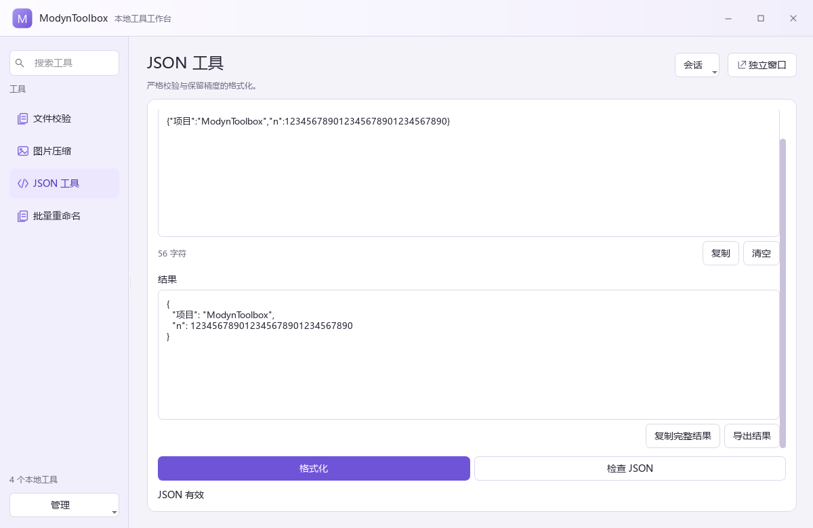
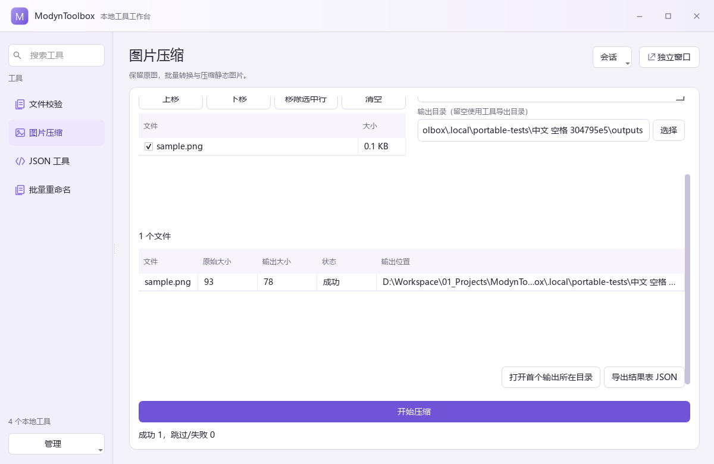
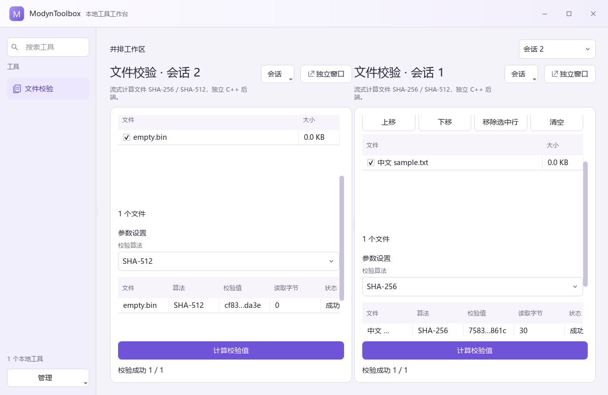

# R2 完整开发交付与验证

日期为 2026-11-09，时区 Asia/Shanghai。对应用户“完成剩余开发并新增工具实测接入”的授权。内部持续开发后一次提交完整成果，用户做最后检查。

## 交付物

项目位于 D:/Workspace/01_Projects/ModynToolbox。根 Open-ModynToolbox.cmd 打开最新便携版，发布目录索引为 .local/releases/latest.json。

最终便携目录为 .local/releases/ModynToolbox-1.0.0-b0803342。共 148486574 字节，约 141.61 MiB，309 项索引文件摘要全部一致。初始 data 为空。根启动器携带相对定位，app 含主程序、可信 WorkerHost、Qt 与 MSVC DLL，tools 各目录含独立工具包和运行时。

发布应用 SHA256 为 b74a86df4940ae9796c6cf16f74303b4e090298f91d478d3cbfe409ffe2b23cd，与冻结的 Release 构建一致。

| 工具 | 版本 | 独立包体积 |
|---|---|---|
| 文件校验 | 1.0.3 | 18542575 字节 |
| 图片压缩 | 1.0.1 | 39350409 字节 |
| JSON | 1.0.2 | 24465608 字节 |
| 批量重命名 | 1.0.1 | 24480565 字节 |

工具采用自包含环境，当前包体包含重复解释器和运行库。安装数量增加会增加磁盘空间，未运行工具只登记元数据，打开时才创建界面，动作执行时才启动后端。

## 完成的公共功能

- 统一浅色雾紫主题和一体化主窗/工具窗外框。搜索在左，工具少时隐藏分类，多会话时显示选择器。无底部重复会话列表。
- 有界 UI 描述加载文件、文本、参数、动作、结果表格与图片预览。工具专用界面由自己的 ui.json 表达。
- 同工具多会话、重命名、并排、浮窗和收回。模型和后台作业归属保持稳定，非当前视图可以释放。
- 后端跨语言独立进程，私有解释器/依赖/工作目录/临时目录。工具代码启动前由可信桥加入 Windows JobObject。
- 全局两槽、默认一重批、同工具串行，队列和预检有界，路径与 Windows 文件身份预约。重批上限可在设置调整。
- 消息标识/序号/修订验证、进度、取消、超时、进程树结束、部分结果和文件事务提交保护。
- 工具包校验、暂存安装、版本固定、同版本拒绝覆盖、被引用版本拒绝移除。删除代码保留工具数据，缺包会话继续保留。
- SQLite 状态、参数/布局、可选草稿、有限运行摘要、运行详情与未读失败提醒、字体和密度设置。
- 一致性数据快照、文件索引、版本预检、暂存、旧数据备份和迁移回滚。
- 结果导出使用统一调度、文件预约和原子保存。导出结束保留原业务结果。
- 较新或损坏状态库拒绝保存覆盖。输入超限或 UI 无法恢复时保留原草稿快照。
- 源码、开发命令、公共协议、工具指南、AGENTS 和交接提示均在项目内。

## 工具真实业务

JSON 独立核心验证严格语法、行列、重复键、深度、NaN/Infinity，格式化保留数字、指数、转义与重复键 token。完整 5 MiB 输入经过真实后端后仍保留完整结果。

图片通过私有 Pillow 处理静态 JPEG/PNG/WebP，支持质量与最长边，应用 EXIF 方向、移除元数据、透明转 JPEG 白底、原图保留、同名编号、受限预览与逐文件取消。

重命名先预览并确认，按文件身份和计划 SHA 复验，使用锁定句柄和两阶段 journal，支持失败回滚、明确恢复与撤销冲突检查。

文件校验为独立 C++ 核心，分块读取 SHA-256/SHA-512。自己的 CLI 可关闭宿主适配后独立构建。

## 全量回归

最终执行 CTest 的两个配置均通过。最近的 CTest-only 复验加入了两个容量边界用例，前面已执行各自完整 dev.ps1 test 编译流程。

| 配置 | CTest 组数 | 失败 | 耗时 |
|---|---|---|---|
| windows-release | 11 | 0 | 19.99 秒 |
| windows-complete / Debug | 11 | 0 | 39.69 秒 |

七个 Qt Test 可执行文件合计 45 个测试函数，另有初始化/清理 14 项，汇总显示 59 passed，零失败、零跳过。其余四组为传输、宿主入口、独立核心和宿主崩溃脚本。业务核心汇总 12 项，不与 CTest 分组数相加冒充同一种统计。

覆盖正常工具调用、多会话/窗口、版本固定、草稿重启、缺失文件、无效草稿保留、未来数据库拒写、导出完整性与取消、SQLite WAL 快照、损坏快照拒绝和迁移回滚。

故障测试覆盖错误标识、消息洪泛、进程崩溃、内存约束、取消、提交阶段及派生进程。宿主崩溃测试只结束自己创建的进程，核对所属进程树清理，重启标记中断且不自动运行。

容量实测包括重命名 2000/2001 个真实文件、图片 500/501 个真实输入、有效图片恰好 50 MiB/再多 1 字节、4000 万像素/超过上限、JSON 5 MiB/超限，以及 2000 行结果表格。

原始汇总在 R2-evidence/release-ctest.txt、debug-ctest.txt、core-regression.json 和 delivery.json。

## 新工具接入实验

第一次冻结宿主后才创建 tools/file-hash。第一次接入 28 步通过，首次安装 284 毫秒、重装 303 毫秒，95 个宿主文件未变化。首次记录保存在 R2-evidence/first-extension.json 和 first-host-check.json。

后续根据截图和完整性检查改进了公共 UI、草稿保护及内部导出，重新编译发布后再次冻结。最终记录为 .local/integration-proof/release-host-final2.json。

最终复验 28 步、1.850 秒，首次安装 277 毫秒、重装 289 毫秒。完整路径包含安装、主导航打开、SHA-256、独立窗口、第二会话 SHA-512/空文件、并排、引用保护、移除、保留数据、重装和再次执行。

95 个冻结文件包括 app、shared、VS Code 配置、宿主构建/包脚本和 Release exe/DLL，前后 SHA256 均相同。发布 exe 另与冻结构建核对。未修改宿主前端、宿主 CMake 或宿主可执行文件即可接入。

以上毫秒数据为成品工具包安装时间。业务设计、核心实现、UI 声明和适配器开发仍需要实际开发时间，工具复杂度会影响工作量。

实际新增内容集中在工具自己的 core、standalone、integration、tests、CMakeLists、build.py、tool.build.json、依赖与许可。core 与 standalone 不引用宿主头文件。另将整个工具源码复制到独立目录，MODYN_WITH_ADAPTER=OFF 编译 CLI，输入 abc 得到标准 SHA256。

### 可复现顺序

在新验证目录使用新的冻结文件名。当前扩展脚本读取下述记录，已有记录保留时不要覆盖。

```powershell
powershell -NoProfile -File scripts/dev.ps1 build -Preset windows-release
python scripts/freeze-host.py freeze --record .local/integration-proof/release-host-final2.json
python tools/file-hash/build.py
python tools/file-hash/tests/verify_integration.py
python tools/file-hash/tests/verify_manual_removal.py
python scripts/freeze-host.py check --record .local/integration-proof/release-host-final2.json
```

当前机器已经存在该记录，可直接 check。新实验需同时将扩展脚本的 record 名称指向新文件，保留原始证据。

## 删除与环境隔离

14 步目录删除实验在自己的测试根移除已安装工具目录，刷新后显示缺包并保留会话。放回同版本目录后恢复参数、文件列表和执行。工具数据哨兵始终存在。正常使用建议先关闭引用会话，通过管理入口移除，或退出后直接删除程序目录。

两个 Python 测试工具分别携带同名依赖 state_dependency，实际返回 private-a/private-b，错误的全局 PYTHONHOME/PYTHONPATH 没有改变结果，各自数据探针独立。记录在 environment-isolation.json。

## 便携发布实测

复制完整发布目录到中文和空格路径，从不同工作目录通过根 ModynToolbox.exe 启动，PATH 只保留 Windows/System32。真实完成 JSON 大整数格式化、重命名预览/执行/撤销、图片 WebP 输出、草稿、浮窗与多会话，共 33 步、3.183 秒。应用未调用系统 Python。测试驱动自身使用开发 Python，应用与工具运行使用包内运行时。

这次验证发生在当前 Windows 电脑。另一台无开发环境普通账户电脑仍需目标设备实测。

## 资源测量

Windows 11 10.0.26300，Intel Family 6 Model 183，20 逻辑处理器，Qt 6.8.3 Release。25 ms 采样，Qt offscreen、文件系统热缓存。以下为本次样本，不作为所有电脑的保证值。

| 场景 | 稳态宿主私有提交 MiB | 宿主工作集 MiB | 整树私有提交峰值 MiB |
|---|---|---|---|
| 空载一会话 | 12.22 | 33.79 | 12.22 |
| 100 个元数据登记项 | 12.35 | 33.63 | 12.38 |
| 20 parked + 1 主区 | 12.75 | 34.18 | 12.75 |
| 20 parked + 5 浮窗 | 26.91 | 48.23 | 26.93 |
| 创建关闭 50 次后 | 13.47 | 34.97 | 13.47 |
| 原生哈希 + 1 MiB JSON | 24.47 | 42.02 | 93.48 |
| 2000 行结果 | 19.61 | 40.97 | 24.55 |

空载准备完成标记约 0.190 秒，表示离屏事件循环就绪。物理冷启动首帧需要设备上另测。空闲 CPU 样本为 0，五浮窗约单核 0.819% / 全机 0.041%。混合任务宿主私有提交峰值 85.72 MiB。工作集求和可能重复计算共享 DLL，私有提交与工作集分开记录。

100 登记项场景只测元数据发现，未执行 100 个工具。不同工具的解码、模型、数据库等负载按各自限制增加资源。原始 performance.json 保留所有场景与采样目录。

## 实现取舍与修正记录

- 大文本直接排版曾造成明显 CPU/内存开销，改用前 32768 个 UTF-16 码元只读预览，完整处理、复制和导出保留。JSON 字符串正则同时优化。
- 早期截图发现并排宽度、空工作区、结果操作定位和恢复文件大小显示问题，已修正并重跑测试。
- SDK 控制读取改为无缓冲管道，Python 入口使用 -B，避免解释器退出与包缓存变更问题。
- 补齐较新数据库拒写、无法恢复草稿保留、迁移前保存失败中止和受管理导出。
- 新回归初始化写法曾编译失败，修正后执行完整编译和测试。全量格式化产生的无关差异经过对照移除。
- windeployqt 对 dxcompiler/翻译/编译环境的探测给出提示，发布脚本显式复制实际 MSVC DLL，保留需要的插件，移除未使用的数据库驱动，便携实测通过。
- 本轮未调用桌面控制或抢占用户键鼠，测试只操作自有进程与私有目录。

当前环境没有可调用的 Context7 工具。版本相关实现结合 Qt 6.8 官方文档、安装 SDK 头文件、Windows API 官方资料及实际编译核对。依赖源与摘要锁定在 runtime.lock，相关许可随包提供。

## 用户最终检查与后续维护

物理 Snap、拖动、Alt+Tab、系统文件对话框、多 DPI/双屏、实际 VS Code F5、另一台干净电脑与真实跨 Agent 接手仍待检查。详见 checklist。

现有公共组件能表达的新工具只改自己的目录和适配。工具应提供完整可执行入口、依赖、manifest、ui.json 和协议结果。新增公共控件、协议、导航或窗口能力时更新宿主。工具数量增加本身无需新增 app 内的工具专用页面分支。

## 实际截图






