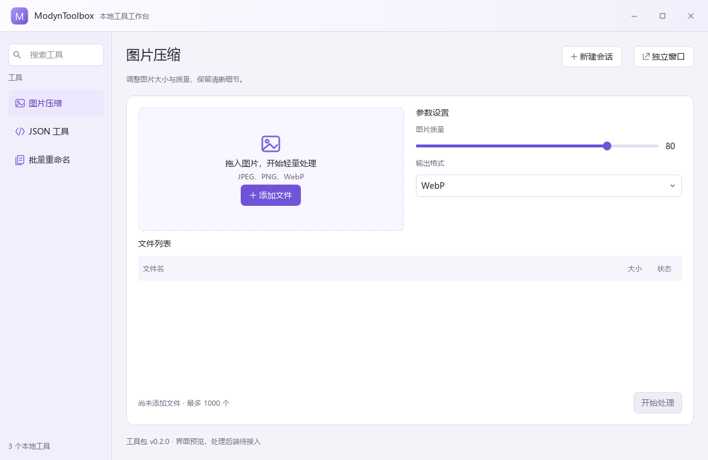

# UI-R1 ModynToolbox 更名与雾紫界面验证

日期为 2026-11-08。用户批准新设计提案、全项目更名和实际优化开发。有效根目录为 D:/Workspace/01_Projects/ModynToolbox。

## 实施结果

维护文件、产品窗口、CMake 目标、可执行文件、工作区、任务名称与 MODYN 环境变量统一更名。旧构建缓存经过绝对路径核验后重建。原目录短暂受到占用，采用项目内容迁移，最终复核旧目录已不存在。

主题集中 ui/theme，图标、下拉框和工具面板集中 ui/components。主窗与工具独立窗复用 ChromeWindow，Windows 适配集中 platform/windows/window_chrome。默认浅色雾紫、左侧搜索、单个工具标题、条件会话选择器。静态绘制图标与渐变，当前没有新增 UI 框架或在线资源依赖。

工具的 integration/ui.json 与 manifest.json 组装到独立安装副本。导航只读取元数据，打开工具才加载界面。当前有界子集支持文件/文本页、选择/范围/文本参数，最大 64 KiB、12 个参数、每组选项最多 20 项。旧清单兼容文本回退，声明 view_file 的包缺失 UI 文件显示局部错误。

文件页可添加/拖入普通文件、去重、按扩展名过滤并限制 1000 个。文本页可编辑、复制和清空。后端待接入，处理按钮禁用。UI 预览不计作已完成真实图片压缩、重命名或 JSON 校验。

多个工具可同时独立成窗，关闭默认收回。修改窗口归属保留相同视图、输入、参数和文件列表。切回浮窗保持最大化，收回恢复最小化主窗。

## 环境与命令

Windows 11 x64，Qt 6.8.3 msvc2022_64，MSVC 19.51，CMake 4.3.1-msvc1，Python 3.13.9。

执行以下入口。

~~~powershell
powershell -NoProfile -File scripts/prepare-preview.ps1
powershell -NoProfile -File scripts/dev.ps1 test -Preset windows-check
powershell -NoProfile -File scripts/dev.ps1 build -Preset windows-dev
~~~

设置 MODYN_PREVIEW_PATH 为项目 .local/ModynToolbox-preview.png 后执行 test，可重建默认、紧凑与独立窗三张离屏截图。截图使用测试临时根内由当前工具源描述组装的包，无用户文件与伪造处理结果。

windows-check 与 windows-dev 均在新根全新配置、编译和部署。后续源码修正进行增量复验。VS Code launch/task JSON 目标、参数、工作目录与脚本匹配，实际 F5 按键本轮未操作。

## 测试结果

最终六组 CTest 全部通过，耗时 5.80 秒，无跳过。27 个实际测试函数，不包含 Qt 初始化/清理钩子。

| 组 | 函数数 | 覆盖 |
|---|---:|---|
| workbench | 9 | 搜索与空态、会话输入、同工具选择、文件拖入/参数、最大化/最小化恢复、品牌与窗口按钮、分离收回、两个独立窗、50 次迁移及截图 |
| package_catalog | 5 | 新增/删除后发现、100 包、数字版本、损坏/超限、未知版本 |
| view_spec | 6 | 旧清单回退、必需界面缺失、参数布局、版本/控件错误、重复/超限、范围/扩展名错误 |
| window_native | 2 | 隐藏 HWND 的原生样式、缩放边缘、拖动区/最大化区命中与取消按钮状态 |
| worker_transport | 3 | C++/Python fixture 的中文消息往返与无效输入 |
| host_start | 2 | 实际 ModynToolbox.App.exe 入口、不同工作目录、私有数据根启动 |

入口冒烟使用受控子进程结束方式，不覆盖优雅退出、未保存草稿与执行中作业关闭。隐藏句柄测试不显示窗口，不模拟物理鼠标拖动。普通 UI 测试使用 offscreen。

原始日志位于 .local/logs/UI-R1-check.log、UI-R1-build-dev.log，Qt 明细位于相应构建根的 workbench-results.txt、catalog-results.txt、view-results.txt、native-results.txt，CTest 明细在 Testing/Temporary。

## 截图观察

默认 1200×780、紧凑 920×600、独立窗 820×660。已查看 Qt 离屏实际渲染，检查中文、图标、左侧搜索、标题区、表头对齐、控件箭头、禁用操作和滚动入口。紧凑窗口通过内容滚动保持控件可达。

截图包含应用绘制的标题区域。DWM 圆角、外部阴影、真实 Snap 菜单、跨 DPI/多屏和系统文件对话框仍待原生桌面验收。

## 静态与迁移检查

有效源码、配置与文档扫描无旧英文品牌标识。历史 Git 与生成日志保存其原始身份，早期深色图片按历史视觉来源标记。检查工作区/调试/任务 JSON、全部工具 JSON、相对文档链接与 Git diff 空白。源码有效配置没有旧项目根依赖。

目录迁移保留 Git 与 data，重建生成的 build 目录。工具 SDK 与引导环境未写入全局安装位置。Qt 部署仍提示翻译元数据、DirectX shader DLL 与 VCINSTALLDIR，当前 Debug 验证可运行，Release 和干净机器部署仍待完成。

## 缺口与下一步

T01 仍需 Job Object 启动归属、完整任务/取消、性能与 Release。T02 仍需完整执行协议、安装事务与忙碌版本固定。T03 仍需完整界面组件树和绑定。工具业务、持久化、并排工作区、迁移发布和全面无障碍验收继续按任务开发。

本轮提供 C01/C03/C05/C24/C26/C29/C33/C34/C37/C38/C40/C43 的局部证据，完整 C01–C44 保持待完成。UI-R1 增量清单单独维护。真实 Windows 系统交互验收尚缺。

## 接口依据

当前无可调用 Context7，核对官方 Qt 6.8 与 Windows 文档并通过本机版本编译验证。

- 原生消息接入参照 [Qt QWidget nativeEvent](https://doc.qt.io/qt-6.8/qwidget.html#nativeEvent)。
- 外框职责参照 [Windows 自定义窗口外框](https://learn.microsoft.com/en-us/windows/win32/dwm/customframe)。
- 最大化命中参照 [Windows Snap 布局](https://learn.microsoft.com/en-us/windows/apps/desktop/modernize/ui/apply-snap-layout-menu)。
- 圆角条件参照 [Windows 圆角说明](https://learn.microsoft.com/en-us/windows/apps/desktop/modernize/ui/apply-rounded-corners)。
