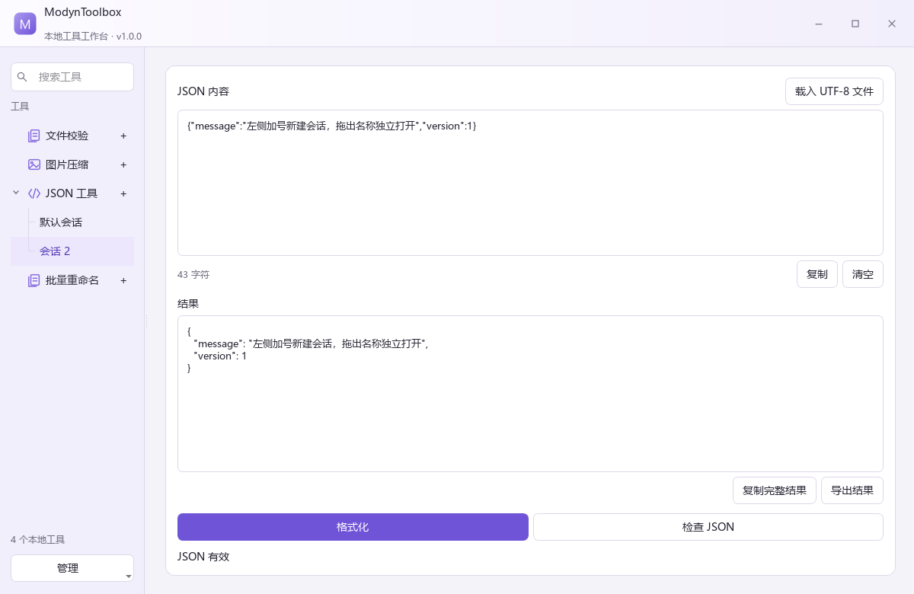
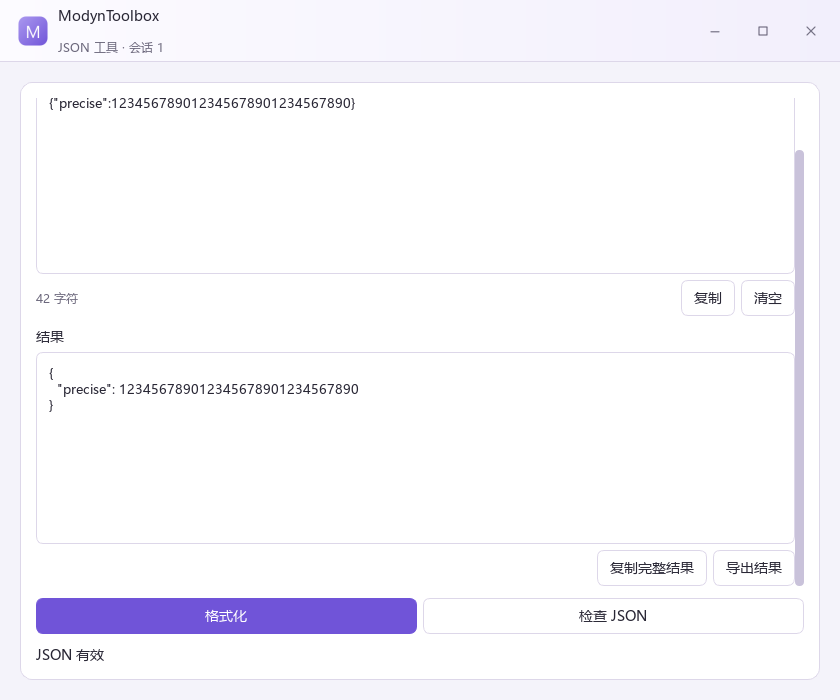
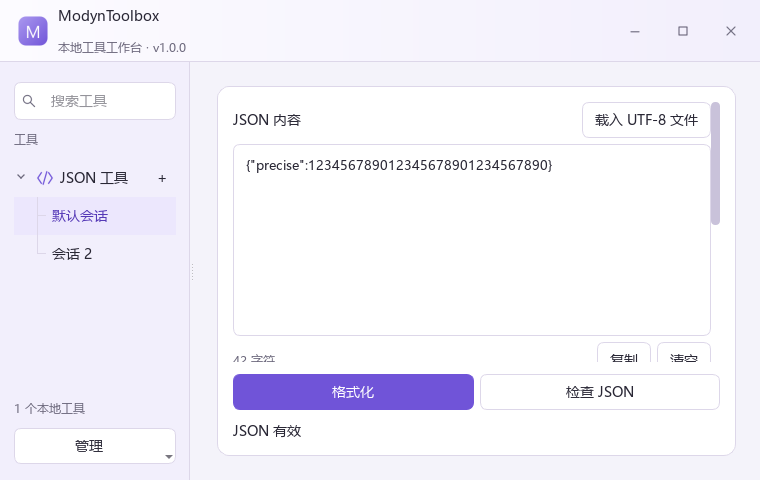

# UI-R3 会话导航与工作区优化

日期为 2026-11-09。用户明确要求直接落实上一轮提出的需求。上次仅交付方案，本轮实际修改代码、编译默认入口并更新便携版。

## 已实现

- 左侧 ToolNavigation 使用工具/会话两级树。每工具右侧 ＋ 创建空白会话，原输入和作业保留。单会话紧凑显示，第二份创建后展开分支。
- 默认会话和其他会话分开选择，支持自定义名称、折叠展开恢复、独立窗标记和缺包会话。搜索及分类继续有效。
- 右键管理独立窗口/收回、新建、重命名、并排、保存草稿与关闭。导航中 Ctrl+N 新建，方向键切换。
- 顶部品牌改为两行，主窗第二行为产品说明和实际 CMake 版本，浮窗第二行为工具与会话名称。
- 中央公共标题、说明、会话选择器、并排标题、会话按钮和独立窗口按钮已迁出。工具自己的输入、参数、动作、进度、错误和结果继续显示。
- 按住名称移动超过系统拖动阈值后启动拖出。拖父工具对应最近会话，拖分支对应指定会话。在主窗口外松开完成，窗口内松开或 Esc 取消。
- 拖出复用原会话和视图，输入、结果及作业归属保留。已分离会话通过导航唤起，浮窗关闭收回，落点按显示器可用区域约束。

单会话隐藏子分支、父工具对应最近会话、主窗口外释放才完成的规则沿用上一轮提案。树形选中行采用连续背景，避免缩进和加号列产生圆角拼接，分支以细折线绘制。

## 修改边界

主要实现位于 app/ui/components/tool_navigation、workbench、window/chrome_window 和 theme。会话业务模型、独立后端、接入协议、工具算法与工具包保持原有语义。新增 navigation_expansion 写入现有状态对象，旧状态默认兼容。

CMake 注册新增控件并传递产品版本。扩展验证脚本增加 --record 参数，以便宿主公共 UI 更新后使用新冻结记录，旧证据继续保留。

本轮没有操作前台桌面或用户键鼠，没有结束用户程序。

## 验证

| 入口 | 结果 |
|---|---|
| dev.ps1 test -Preset windows-complete | 11/11，41.14 秒 |
| dev.ps1 test -Preset windows-release | 11/11，22.52 秒 |
| 实际 JSON 后端与窗口截图 | 主窗、浮窗、最小窗通过 |
| 最新便携包中文/空格路径验证 | 33 步，3.336 秒 |
| 冻结新版宿主后兼容工具接入 | 28 步，1.933 秒 |
| 工具安装/重装 | 277 / 304 毫秒 |
| 冻结文件 | 97 个，接入前后 SHA256 相同 |
| 发布目录校验 | 309 项摘要一致，初始 data 为空 |

加号、分支、Ctrl+N、独立输入、窗口内释放取消、Esc 取消、子会话与父工具拖出、关闭浮窗收回均通过合成输入回归。系统测试通过左侧真实上下文菜单重命名，并验证折叠状态重启恢复。原业务、取消、资源争用、数据恢复和进程树回归继续通过。

离屏截图初次缺少字体，已在测试入口显式加载 Windows 字体后重新检查。迁移树控件时旧测试残留的列表 API 曾编译失败，替换为实际点击行为后重新完整编译通过。最终截图没有使用最初的缺字版本。

原始摘要、冻结记录和发布信息保存在 UI-R3-evidence。R2 报告保留历史范围，本轮更新宿主后使用独立 UI-R3-host.json 复验。

## 运行

用户原命令保持有效。

```powershell
powershell -NoProfile -File "D:\Workspace\01_Projects\ModynToolbox\scripts\dev.ps1" run
```

该命令编译并启动 .local/build/windows-complete/bin/Debug/ModynToolbox.App.exe。已打开的旧窗口需要退出后重新启动。

Open-ModynToolbox.cmd 指向最新便携目录 .local/releases/ModynToolbox-1.0.0-f2b221c8。发布 app SHA256 为 6936d2f485a80b5b5c582685e646da23318845e2badabb9d8ca9b8b870bf93ea。

## 设备验收范围

离屏输入验证覆盖程序的手势处理、取消和状态保留。真实桌面鼠标捕获、跨显示器拖出、Snap 和不同 DPI 仍需物理设备检查。

当前环境没有可调用 Context7，使用已安装 Qt 6.8.3 头文件和 Qt 6.8 官方文档核对树节点、鼠标事件与输入接口。[QTreeWidget](https://doc.qt.io/qt-6.8/qtreewidget.html)、[QMouseEvent](https://doc.qt.io/qt-6.8/qmouseevent.html)

## 实际截图






