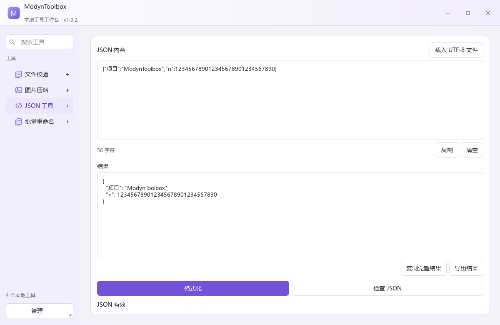
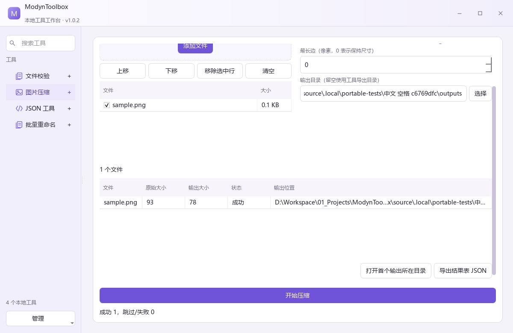

# REL-1 正式发布与公开下载验证

日期为 2026-11-10，用户时区 Asia/Shanghai。

## 最终公开版本

ModynToolbox 1.0.2 已公开发布到用户指定仓库。Release ID 为 439406767，服务端发布时间为 2026-11-09T17:21:59Z。

[GitHub Release](https://github.com/HaiboQiao/ModynToolbox/releases/tag/v1.0.2)

固定源提交为 8a45e58e2f395e3e9864d54e07fe30b17915acf3，v1.0.2 标签与其一致。source 下的源码 ZIP 从该提交导出，附 SOURCE-REVISION.json。发布后记录使用独立文档提交，主程序代码和发布来源继续固定。

## 仓库组织

根只承担入口和路由。source 保留完整工程、AGENTS、开发与发布规程、工具、测试和记录，releases/1.0.2 保存下载、校验与发布回执。运行 ZIP 和独立工具 ZIP 作为 GitHub Release assets 分发。

源码与开发缓存分离。用户数据、SDK、构建和上传进度排除 Git 与源码 ZIP。普通用户下载完整便携版，完整解压后双击 ModynToolbox.exe，保留同级 app/tools/data/licenses。

## 资产

| 文件 | 字节 |
|---|---|
| ModynToolbox-1.0.2-windows-x64.zip | 64806780 |
| ModynToolbox-tool-file-hash-1.0.4-windows-x64.zip | 5060856 |
| ModynToolbox-tool-image-1.0.1-windows-x64.zip | 19510278 |
| ModynToolbox-tool-json-1.0.2-windows-x64.zip | 12355322 |
| ModynToolbox-tool-rename-1.0.1-windows-x64.zip | 12359651 |
| ModynToolbox-1.0.2-source.zip | 4201229 |

另有 release-manifest.json 和 SHA256SUMS.txt，共 8 项公开资产。完整包携带四个工具，各工具也有独立 ZIP。工具版本与宿主独立，顶层 <id>/<version> 解压到应用 tools 后可刷新发现。

## 实际验证

- source 新路径 Release 11/11 CTest，21.40 秒，Debug 11/11，40.71 秒。
- 正式准备阶段验证 ZIP CRC、安全路径、源提交、源码 AGENTS/README/发布规程、空数据目录和全部包内 SHA256。
- 编译程序 --version 与分发版本 1.0.2 一致。
- ZIP 解压后从中文空格路径通过根启动器完成 33 步真实业务验证，受限 PATH 只含 Windows/System32，应用使用包内运行时。
- 已启动的空工具宿主中解压独立文件校验包，再刷新目录、打开并计算 SHA-256，实际结果正确。
- 正式上传从已含校验清单的草稿检查点恢复，验证认证列表查找草稿和复用匹配资产。
- 8 项服务器资产大小与 SHA256 均匹配，齐全后公开。
- 公开后匿名重新下载 8 项，大小和 SHA256 全部一致。
- 下载的完整 ZIP 再次解压运行，33 步通过，3.187 秒。

正式资产中的 data 为空，工具运行环境随包提供。测试驱动本身使用开发 Python，应用与工具使用发行物的私有运行时。

## 发布规程与网络恢复

根和 source 的 AGENTS 均要求发布前先读 source/docs/release-policy.md。脚本统一准备、验证与上传，版本来源为 CMake，固定提交/标签和机器可读清单提供溯源。

首次 1.0.1 候选保留源标签，未公开的草稿已清理。原 HTTP 大文件写入时限不足，实测流式传输后改用 Windows curl 的有界长时限上传，认证配置通过标准输入传入，进度仅放 .local。为保留既有标签来源，正式分发使用新 1.0.2 标签。

## 公开证据

[版本目录与回执](https://github.com/HaiboQiao/ModynToolbox/tree/main/releases/1.0.2)

REL-1-evidence 中保留双配置测试、预检、流式链路、草稿检查点、正式 ZIP 验证和公开下载运行摘要。完整本地日志集中 .local，Git 只保存精简证据和记录。

## 设备边界

当前根 exe 未做 Authenticode 签名。另一台干净电脑、实际跨屏 DPI/Snap 和系统交互仍需目标设备验收，当前结果不包含这些未执行场景。

## 下载版实际截图

