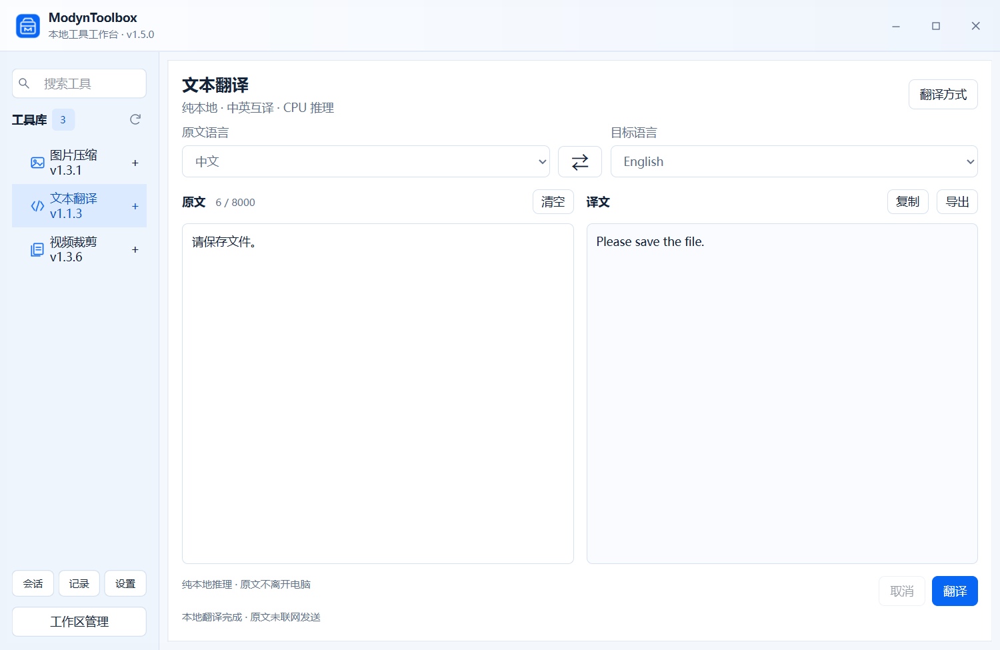

# UIR-10：蓝色主题、视频时间轴与纯本地翻译

日期：2026-11-17。对应本次用户明确要求优化并发布；宿主1.5.0，图片1.3.1、视频1.3.6、翻译1.1.3。此处记录实测范围；正式发行及公开下载结果在本报告末尾补入。

## 交付与边界

- 公共壳、B标识及三个默认工具由紫转蓝。工具各自维护页面/CSS，宿主没有注入业务主题或按工具ID分支；原有完整前端所有权、独立进程、固定版本、数据/包分离均保留。
- 视频改为单条选区时间轴：左右起止柄、独立播放头、毫秒级秒数输入相互同步。添加视频明显；导出参数标签/控件同排，小窗口可展开设置浮层，预览随高度缩小，正常编辑页不靠整页滚动。精确裁剪直接导出；快速截取仍须准备且确认参数未变。取消、原文件与事务保护保持。
- 翻译默认为完整随包模型的本地CPU推理，中英互译不需网址/Key、系统Python、首次下载或GPU。可选在线/自建仍由用户主动选择，本地失败不偷偷联网。模型是OPUS-MT/Argos1.9经CTranslate2 int8推理；不是大型语言模型，简短技术语句、专名/复杂句及极长文本质量仍有限，不宣称商用云翻译等质。
- 鼠标动作按钮不抢键盘焦点；关闭设置/记录/会话后无伪选中，Tab和Space仍可操作。主题焦点边线1px，不通过禁用所有键盘焦点解决。
- 本地完整翻译包约293.8MiB，旧通用安装256MiB预算不足。通用包安装上限改512MiB，4096文件/路径/完整性验证保留；copyTree增加显式预算参数，其余调用默认256MiB不变。翻译最低宿主1.5.0，既有工具最低版本不盲目抬高。

## 最终源码验证

- `dev.ps1 test -Preset windows-release -GuardTask uir10-blue-offline`：真实CTest全部20/20通过，138.22秒；冻结宿主SDK接入另20步通过25.630秒（不是20个CTest重复计数）。
- `dev.ps1 test -Preset windows-complete`：最终Debug全部20/20通过，216.42秒。发布配置/Debug均包含新增translation_offline。
- 原生WebView2验证1200×780、900×600、760×480主窗：核心导入/预览/起止与播放头/导出在窗口内，无水平或垂直页面溢出；使用真实CDP指针拖起点、终点、播放头验证同步，而非仅JS改值。下拉实际滚轮不改参数，键盘箭头仍可选。
- 实际视频页面精确导出与快速准备/导出均经过真实后端；旧回归继续覆盖恢复、取消、崩溃树及多个会话/分离收回。
- 公共按钮回归逐一鼠标打开/关闭设置、记录、会话，核对非checkable/down/焦点残留，并核对键盘Space激活。
- 模型私有解释器在网络socket被明确禁用的进程中完成英→中、中→英、段落换行与预取消；模型文件缺失/非支持语言给明确错误。原生宿主桥/512MiB JobObject内的双向本地推理及原在线loopback适配合计24步通过。
- 冻结SDK使用两种后端Python/C++、两个独立前端，导出SDK后只增包，不改宿主，实际放目录自动发现/运行20步。简要结果见附件。

## 资源与真实故障修正

初次默认CT2/MKL实测单方向峰值提交约926MiB，超过JobObject内存预算；不能只看约166MiB工作集就误称轻量。只在翻译私有进程、CT2导入前设置CT2_USE_MKL=0、MKL_DISABLE_FAST_MM=1、CT2_PACKED_GEMM=0。修正后单方向峰值提交139.94MiB/工作集135.14MiB，同进程载入两个方向峰值提交231.26MiB/工作集228.65MiB，样例约0.17–0.27秒。这是本机短句、模型进程口径，排除宿主/WebView2，不是任意长文或所有电脑性能承诺。原始对照附后。

中间验证暴露并修正：视频恢复未重新分析时不应错误禁止显式导出（由后端最终校验）；默认内边距须保持原≤12px契约；响应式设置展开后滚轮可能滚动实际嵌套祖先，测试保留防误改/细焦点断言并加入真实CDP操作，而非删掉保护；Qt会话弹出的是QMenu，测试关闭器同时处理QMenu/QDialog。

Debug曾在CRT预初始化、进入main之前崩溃，私有调试器只启动自有测试进程，栈为__scrt_initialize_type_info/pre_c_initialization，无产品业务帧。确认缓存属于本项目后仅干净重建Debug产物；未改worker调度/作业逻辑。干净重建及最终全量均20/20通过。不能据此声称已证明某个编译器缺陷。

Windows PowerShell5签名模块在混合宿主环境自动导入产生重复TypeData；发布脚本改用强名称解析本机内置Security二进制模块并调用原生签名检查。真实无证书分支对三个自有EXE检查均NotSigned。正式证书签名分支因未提供签名身份保留未执行，不能当成已完成可信签名。

## SmartScreen与许可

当前未提供正式可信代码签名证书；本版真实未签名。package在SHA256清单前调用签名/状态脚本并携带signing-report.json；可用MODYN_SIGN_CERT_SHA1指定用户实际拥有的当前用户代码签名身份，校验私钥/用途/有效期，SHA256+RFC3161时间戳，失败停止。没有凭空生成自签名、移除下载标记、关闭SmartScreen、购买证书或注册付费服务。

[微软官方说明](https://learn.microsoft.com/windows/apps/package-and-deploy/smartscreen-reputation)：未知应用由文件/发布者信誉参与判定；可信签名能识别发布者，但新文件仍可能提示，EV也不保证直接免提示。当前包在其他电脑仍可能出现警告，这部分无法承诺已消除。

OPUS模型原始README明确CC-BY-4.0，已保留作者归属、原始README与完整许可；不误用Argos应用MIT许可替代模型许可。私有wheel保留dist-info许可。下载URL/版本/SHA256在offline.lock.json，模型/wheel不进入源码Git历史，只进入完整运行包。

补充禁网实测：1680字符英文长文确实跨分块推理，输出559字符中文；执行中第5次取消检查生效，缺模型分支明确报错（测试仅重定向模块资源基址，不改包文件）。结果见offline-extra.json，约1.968秒；不把此样例当一般质量基准。

## 图像与证据

截图来自原生后台私有实例，不接管用户桌面。视频彩条是自动生成测试视频；没有拿设计参考图冒充运行效果。

其他截图与简要JSON/内存对照见[UIR10-evidence](UIR10-evidence)。

## 待设备实测

本机Windows x64原生后台UI与受控测试不替代另一台干净PC、物理多屏DPI/Snap、IME、真正登录自启动、不同编解码/听感、超大媒体/真实空间ACL检查。旧会话仍锁原工具版本，不强迁未知状态；新包新建会话或点击打开新版，升级前备份data。尚未提供正式签名身份，因此不能承诺警告消失。

## 正式发行验收

首次正式ZIP解压发现测试根重复长包名导致NumPy许可证路径达264字符，触及Windows传统路径上限。保留全部原始许可与完整包，将release.py的私有验证根由.local/distribution-tests缩短为.local/d，后续实际重跑验收。仅改变验证目录名，不影响产品路径/数据/前后端。

待固定干净源提交、正式便携包/独立工具ZIP验收和GitHub匿名下载校验后记录；此处不提前宣称发布完成。
